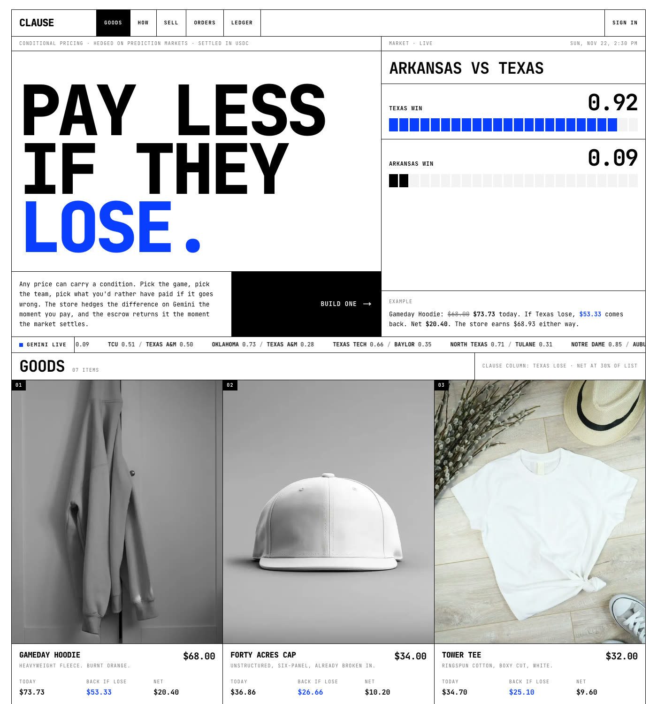
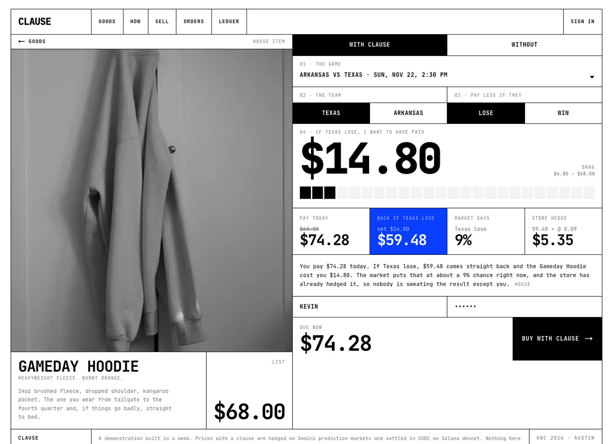
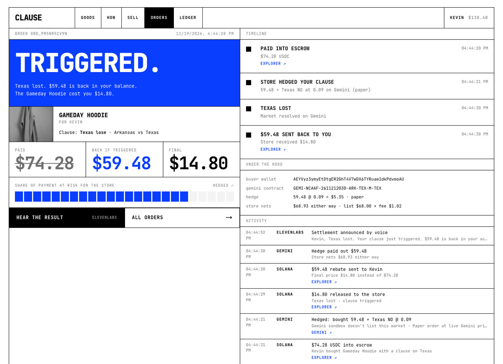
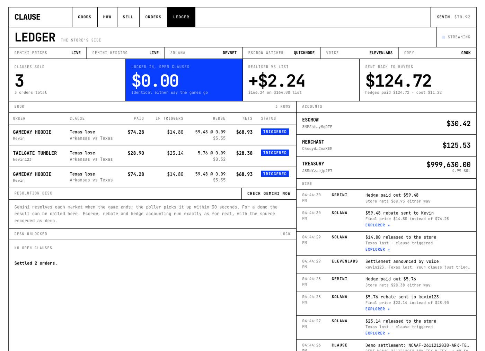
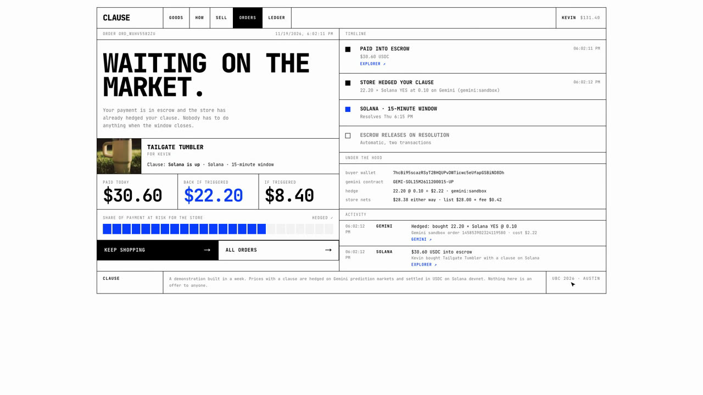
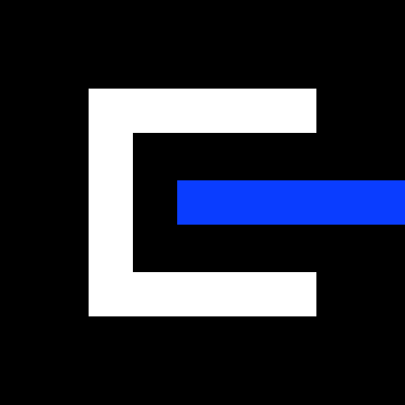

<p align="center">
  
</p>

<p align="center">
  <a href="https://clause.korcuda.com"><b>Live site</b></a> ·
  <a href="https://clause.korcuda.com/video/demo"><b>Demo video (1:34)</b></a> ·
  <a href="#the-math">The math</a> ·
  <a href="#how-its-built">How it's built</a> ·
  <a href="#run-it-locally">Run it locally</a>
</p>

<p align="center">
  
  
  
  
  
</p>

---

**Clause is a store where any price can carry a condition.**

> Gameday Hoodie, $68. Or pay **$73.77 today and get $53.77 back if Texas lose**, so it cost you $20.

The buyer picks a game, a team, and the price they'd rather have paid if it goes wrong. Clause solves for today's price from live odds on Gemini's prediction market, hedges the difference the moment they pay, and settles the rebate from a USDC escrow on Solana when the market resolves. The buyer never sees a wallet, a chain, or a market. Anyone can sell on it, and sellers are paid list price whichever way the game goes.

Built in a week for the **University Blockchain Conference 2026** hackathon in Austin. Consumer Applications track · Best use of Solana · Gemini Prediction Markets · QuickNode Streams · ElevenLabs.

<p align="center">
  
</p>

## Sixty-second tour

<table>
<tr>
<td width="50%" valign="top">

<b>1 · Build the clause.</b> Pick the game, the team, and drag to the net price you'd accept on a bad day. Pay-today, rebate, implied odds and the store's hedge all update from the live order book.
</td>
<td width="50%" valign="top">

<b>2 · It settles itself.</b> Gemini resolves the market, the resolver sees it within 30 seconds, escrow pays the store and the rebate goes back on chain. ElevenLabs reads the result aloud.
</td>
</tr>
<tr>
<td width="50%" valign="top">

<b>3 · The store's side.</b> Every order with what it nets either way, every hedge, the live wire of chain and market events, and a resolution desk for demos.
</td>
<td width="50%" valign="top">

<b>4 · Live on Gemini.</b> Clauses on Gemini's 15-minute crypto windows place a real order on the sandbox exchange. The order ID is on the receipt and the window resolves within the hour, no human involved.
</td>
</tr>
</table>

**Try it:** go to [clause.korcuda.com](https://clause.korcuda.com), sign in with any name and a passcode, add funds, pick a game or a crypto window, buy. Crypto clauses settle on their own; sports clauses can be called from the Ledger with the demo token `clause-demo`.

## The math

For list price `B`, the buyer's chosen bad-day price `L`, and `q` the market ask for the clause triggering:

```
W = (B − L·q) / (1 − q)        price paid today
N = W − L                       contracts bought at q, each pays $1 if the clause triggers

no trigger:  store keeps W, hedge expires     →  W − N·q      = B
trigger:     store keeps L, hedge pays N      →  L + N − N·q  = B
```

The store nets `B` either way, plus a 1.5% clause fee that covers the spread. The whole pricing engine is [`src/lib/pricing.ts`](src/lib/pricing.ts); the app's [`/how`](https://clause.korcuda.com/how) page walks through a worked example.

## How it's built

```
                   ┌──────────────────────────────────────────────────────┐
 buyer's browser ─►│  Next.js 16 · app router · SQLite                    │
                   │                                                      │
                   │  /p/[slug]   ClauseBuilder   ─►  /api/quote          │
                   │  /orders/id  Receipt (SSE)   ◄─  /api/stream         │
                   │  /sell       listings        ─►  /api/listings       │
                   │  /merchant   Ledger          ◄─  /api/merchant       │
                   │                                                      │
                   │  lib/orders.ts    checkout → hedge → settle → rebate │
                   │  lib/pricing.ts   W = (B − L·q) / (1 − q)            │
                   │  lib/resolver.ts  polls Gemini resolutions every 30s │
                   └───┬──────────────┬───────────────┬───────────────┬───┘
                       ▼              ▼               ▼               ▼
                Gemini Prediction   Solana devnet    QuickNode       ElevenLabs
                Markets             USDC (SPL)       Streams + RPC   TTS
                · live prices       · buyer wallet   · escrow        · settlement
                · IOC hedge orders    (custodial)      webhook         announcement
                · resolutions       · escrow vault   · HMAC verified
                                    · memo'd txs     · RPC poller
                                                       fallback
```

### What each integration does

| | Where | What's real |
|---|---|---|
| **Solana** | [`src/lib/solana.ts`](src/lib/solana.ts), [`src/lib/orders.ts`](src/lib/orders.ts) | Every payment, escrow release and rebate is an SPL USDC transfer on devnet, memo-tagged `clause:<order>:<step>`, linked to the explorer from the receipt. Treasury pays fees so buyers never hold SOL. |
| **Gemini Prediction Markets** | [`src/lib/gemini/`](src/lib/gemini/) | Public API drives every quote. Authenticated client places immediate-or-cancel limit orders and reads `resolutionSide` to settle. Crypto windows trade for real on the sandbox; sports books are quoted from production and paper-hedged, labelled as such. |
| **QuickNode** | [`src/lib/quicknode.ts`](src/lib/quicknode.ts), [`docs/quicknode-filter.go`](docs/quicknode-filter.go) | RPC endpoint for all chain traffic. A Streams filter (Go) keeps only transactions touching the escrow wallet and posts to `/api/webhooks/quicknode`, verified with QuickNode's HMAC scheme. Without a token an RPC poller emits the same feed events. |
| **ElevenLabs** | [`src/lib/voice.ts`](src/lib/voice.ts) | Settlement is spoken ("Kevin, Texas lost. Your clause just triggered…"), cached per order. Falls back to browser speech. |
| **Grok** | [`src/lib/copilot.ts`](src/lib/copilot.ts) | One plain-English line under the slider, written by `grok-4-fast` when a key is set, templated otherwise. |

### Money flow

All SPL USDC transfers. `W` is paid today, `L` the bad-day price, `B` the list price.

| Step | From | To | Amount |
|---|---|---|---|
| Add funds (card on-ramp stand-in) | treasury | buyer wallet | top-up |
| Checkout | buyer wallet | escrow | `W` |
| Settle, no trigger | escrow | store | `W` |
| Settle, trigger | escrow | store | `L` |
| Rebate, trigger | escrow | buyer wallet | `W − L` |
| Seller listing, no trigger | escrow | seller `B`, house `W − B` | |
| Seller listing, trigger | escrow, hedge payout | seller `L` + `B − L` | |

<details>
<summary><b>Marketplace and auth</b></summary>

`/sell` lets any account list an item with a photo (upload or URL) and a list price. It appears in Goods beside the house items and takes clauses on any open market. Clause is the hedger of record: it carries the hedge, collects the payout, pays the seller list price either way, and keeps the fee.

Accounts are a name plus a passcode (scrypt). A new name creates the account; a known name must present its passcode. Sessions are HMAC-signed httpOnly cookies. Every account gets a server-custodied Solana keypair on creation, which is what makes the chain invisible at checkout. The Ledger's resolution desk is locked behind `ADMIN_TOKEN`, held as a separate signed cookie.
</details>

<details>
<summary><b>Hedge venue and crypto clauses</b></summary>

Catalog prices come from production Gemini, where the real sports books are. The sandbox, where the API key trades, lists only its own 5/15/60-minute BTC, ETH and SOL windows. So:

- A clause on a **sports** market quotes live production odds and books a paper hedge at that price; the feed says so.
- A clause on a **crypto window** (offered as "Solana · 15-minute window", tickers prefixed `sbx:`) places a real IOC order on the sandbox. The Gemini order ID is on the receipt and the order settles from Gemini's own resolution, usually within the hour, with no admin desk involved.

Orders that paid but never got a hedge row are re-hedged on boot. Wording for both kinds ("Texas lost" / "Solana was down") comes from [`src/lib/phrase.ts`](src/lib/phrase.ts).
</details>

<details>
<summary><b>What's demo-grade, honestly</b></summary>

- Escrow is a server-held wallet, not an on-chain program. Trust sits with the operator.
- "Add funds" mints test USDC from the treasury. A product would put a card on-ramp (Circle, Stripe) in its place.
- Keys are custodial on the server. A product would use embedded wallets (Circle Programmable Wallets, Privy).
- No handling yet of partial fills, markets closing mid-checkout, or refunds.
- Production trading needs a funded Gemini account, and a store placing prediction-market trades has state-by-state rules to deal with.
</details>

## Run it locally

```sh
npm install
cp .env.example .env.local      # everything optional; see below
npm run setup:solana            # creates ./.keys/{treasury,escrow,merchant}.json
npm run dev                     # http://localhost:3000
```

Fund the treasury address printed by setup with devnet SOL ([faucet.solana.com](https://faucet.solana.com)) and devnet USDC ([faucet.circle.com](https://faucet.circle.com), Solana Devnet). For offline development, `npm run setup:solana -- --test-mint` against a local `solana-test-validator` creates a throwaway mint and funds the treasury.

### Environment

| Variable | Set | Unset |
|---|---|---|
| `SOLANA_RPC_URL` | Any RPC; a QuickNode devnet endpoint is ideal | public devnet |
| `USDC_MINT` | SPL mint for payments | Circle devnet USDC `4zMMC9…ncDU` |
| `GEMINI_API_KEY` / `GEMINI_API_SECRET` / `GEMINI_ENV` / `GEMINI_ACCOUNT` | Real hedge orders. Create the key with **time-based nonce**; a `master-…` key needs `GEMINI_ACCOUNT` (default `primary`) | paper hedges at live prices |
| `QUICKNODE_WEBHOOK_TOKEN` | Verifies Streams webhooks | RPC poller on the escrow wallet |
| `ELEVENLABS_API_KEY` | Spoken settlements | browser speech |
| `XAI_API_KEY` | Grok writes the checkout line | templated copy |
| `ADMIN_TOKEN` | Unlocks the demo resolution desk | `clause-demo` |
| `SESSION_SECRET` | Signs session cookies | generated once into `data/` |

### Deploying

The app is a single Next.js server with SQLite and keypairs on disk, so it wants a persistent host, not a serverless one. The live instance runs in an LXC container behind a Cloudflare tunnel: `npm ci && npm run build && npm run start`, with a systemd unit and `TZ` set to the venue's timezone.

## Repository map

| Path | What |
|---|---|
| `src/lib/pricing.ts` | Clause math and slider bounds |
| `src/lib/orders.ts` | Checkout, hedge, settle, rebate, seller payouts |
| `src/lib/gemini/` | Public market data (with disk cache and snapshot fallback), trading client |
| `src/lib/solana.ts` | Keypairs, USDC transfers, balances |
| `src/lib/quicknode.ts` | Streams webhook verification, RPC poller fallback |
| `src/lib/resolver.ts` | Settlement poller |
| `src/lib/phrase.ts` | Condition wording for sports vs crypto clauses |
| `src/lib/voice.ts`, `src/lib/copilot.ts` | ElevenLabs, Grok |
| `src/lib/auth.ts`, `src/lib/session.ts` | Passcodes, signed cookies, admin session |
| `src/components/ClauseBuilder.tsx` | Product-page clause UI |
| `src/components/Receipt.tsx` | Live receipt: timeline, explorer links, voice |
| `src/components/Merchant.tsx` | Ledger: book, P&L, resolution desk, live wire |
| `src/components/Sell.tsx`, `src/app/api/listings/` | Seller listings and uploads |
| `src/app/video/` | Demo video page and the teleprompter used to record it |
| `docs/quicknode-filter.go` | The Streams filter running on QuickNode |
| `docs/brand/` | Mark, lockups, social card |
| `scripts/setup-solana.ts` | Key generation, airdrop, optional test mint |

## What we'd build next

- An on-chain escrow program with per-order PDAs, so settlement is verifiable without trusting the store.
- Embedded wallets and a card on-ramp, so Clause never custodies keys or mints test money.
- Seller payouts to a bank or external wallet.
- A Shopify app: one toggle on the product page, Clause handles pricing, hedging and settlement behind it.
- Clauses on anything with a market: tickets refunded if the headliner cancels, flights hedged on weather, rent that drops if the Fed hikes.

## Brand

<p>
  
</p>

Black, white, one blue. JetBrains Mono for everything. The mark is a bracket-C with the strike that runs through every struck-out price in the app. Assets in [`docs/brand/`](docs/brand/).

---

Built Nov 13–20, 2026 at UT Austin for UBC 2026.
